<picture>
  <source media="(prefers-color-scheme: dark)" srcset="assets/banner-dark.svg">
  
</picture>

  
  
  <!--  -->
  <!--  -->

<i>The banner is a small network: node size is PageRank, colours are communities, and the moving dot is a random surfer.</i>

### Hi, I'm Faezeh

I'm an MSc student in IT Engineering at the **University of Tehran**. I work on how machines read text, find what matters in it, and follow how ideas spread between people:

- **Language** — tokenizers, word vectors, sequence labelling, translation, and fine-tuning transformers.
- **Retrieval & ranking** — search models, learning to rank, and retrieval-augmented chatbots.
- **Networks** — link analysis, community detection, and information diffusion on social platforms.

I like to build methods from scratch once, check them against a reference, and then measure them honestly.

---

### Selected work

<table>
<tr>
<td width="50%" valign="top">

**💬 [RAG chatbot over a textbook](https://github.com/faezehmzf/slp3-rag-chatbot-langgraph)** 
Answers questions about *Speech and Language Processing*: an LLM router, hybrid FAISS + BM25 retrieval, web search and a fallback for off-topic questions, built with LangGraph. 
<kbd>6 / 6 routed correctly</kbd> in a live run with Llama-3-70B 
`RAG` `LangGraph` `FAISS` `BM25`

</td>
<td width="50%" valign="top">

**🔎 [Job–candidate ranking](https://github.com/faezehmzf/job-candidate-ranking)** 
Learning to rank applicants for jobs: cleaning, 51 job–candidate features, grouped cross-validation, LightGBM and XGBoost rankers. 
<kbd>NDCG@10 0.858</kbd> vs. 0.424 without feature engineering 
`learning-to-rank` `LightGBM` `XGBoost`

</td>
</tr>
<tr>
<td width="50%" valign="top">

**🏷️ [Semantic role labelling: tagging vs. generation](https://github.com/faezehmzf/srl-tagging-vs-generation)** 
The same task solved two ways: BIO tagging (BiLSTM-CRF, RoBERTa) and question-answer generation (seq2seq, FLAN-T5). 
<kbd>span F1 0.529 → 0.880</kbd> from BiLSTM to RoBERTa + CRF 
`NLP` `PyTorch` `Transformers`

</td>
<td width="50%" valign="top">

**⚡ [Parameter-efficient fine-tuning](https://github.com/faezehmzf/roberta-peft-mnli)** 
Full fine-tuning vs. LoRA vs. soft prompts on RoBERTa-large for natural language inference (MultiNLI). 
<kbd>LoRA 81.6%</kbd> training only 1.3% of the weights 
`PEFT` `LoRA` `RoBERTa`

</td>
</tr>
</table>

<b>More projects</b>

 

| Area | Project | In one line |
|---|---|---|
| Retrieval | [bm25-vs-language-models](https://github.com/faezehmzf/bm25-vs-language-models) | BM25, PL2 and query-likelihood models with EM feedback, cross-validated with significance tests |
| Retrieval | [graph-ranking-and-text-weighting](https://github.com/faezehmzf/graph-ranking-and-text-weighting) | PageRank, HITS and SALSA checked against NetworkX; TF-IDF as a MapReduce job |
| Language | [tokenizers-and-ngram-lms](https://github.com/faezehmzf/tokenizers-and-ngram-lms) | BPE, WordPiece and Kneser-Ney language models, tested against Hugging Face |
| Language | [tfidf-ppmi-word2vec](https://github.com/faezehmzf/tfidf-ppmi-word2vec) | Sparse counts, PPMI and skip-gram vectors compared with GloVe |
| Language | [english-persian-nmt-fairseq](https://github.com/faezehmzf/english-persian-nmt-fairseq) | English→Persian translation with fairseq: LSTM vs. Transformer |
| Speech | [spoken-language-identification](https://github.com/faezehmzf/spoken-language-identification) | Four-language identification from speech, evaluated on narrators the model has never heard |
| Networks | [information-diffusion-network-analysis](https://github.com/faezehmzf/information-diffusion-network-analysis) | Influence (HITS, PageRank), k-cores and communities (Louvain, Infomap) in six retweet and forward networks |
| ML | [life-expectancy-mlp](https://github.com/faezehmzf/life-expectancy-mlp) | MLPs on WHO indicators, tested on countries the model has never seen |
| Statistics | [Pima-Diabetes-Stat-Inference](https://github.com/faezehmzf/Pima-Diabetes-Stat-Inference) | Estimation, hypothesis tests and regression on the Pima diabetes data |
| Optimisation | [Bio-CPG-Optimization](https://github.com/faezehmzf/Bio-CPG-Optimization) | A genetic algorithm that tunes a walking gait for a six-legged robot in Webots |

---

### How I work

- 🧪 **Check against a reference.** My from-scratch BPE matches Hugging Face on 92.7% of unseen words; my PageRank and TF-IDF are tested against NetworkX and scikit-learn.
- 🧱 **Split by what must generalise.** Countries the model never saw, job groups kept apart in cross-validation — so the score means what it says.
- 📏 **Always show the baseline.** Every result sits next to a random or simple baseline, over several seeds when the gap is small.
- ✅ **Tests and CI.** My recent repositories come with tests that run on GitHub Actions.

---

### Toolbox

  

**NLP** Hugging Face Transformers · PEFT · fairseq · SentencePiece 
**Retrieval & LLMs** LangGraph · FAISS · BM25 · LightGBM / XGBoost rankers 
**Networks & data** NetworkX · Infomap · Gephi · pandas · NumPy · MRJob

---

  Happy to talk about NLP, search and ranking, or social networks — <a href="https://www.linkedin.com/in/faezeh-mozaffari-7816b6230/">LinkedIn</a> · <a href="mailto:faezeh.m7899@gmail.com">email</a>

